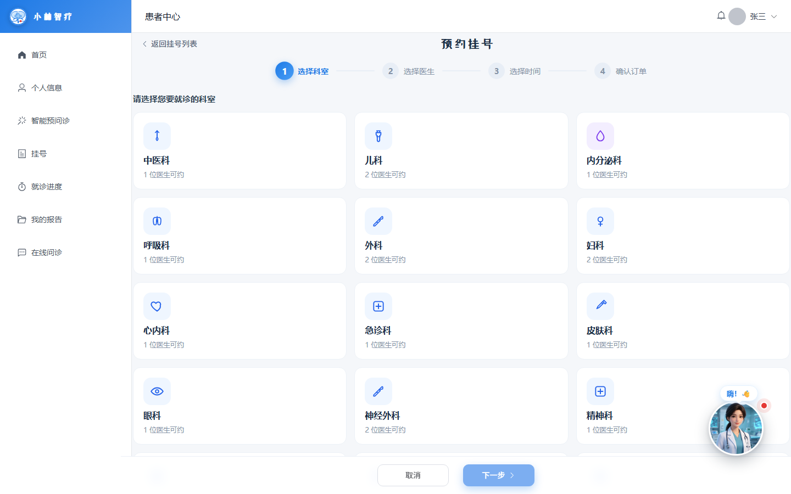
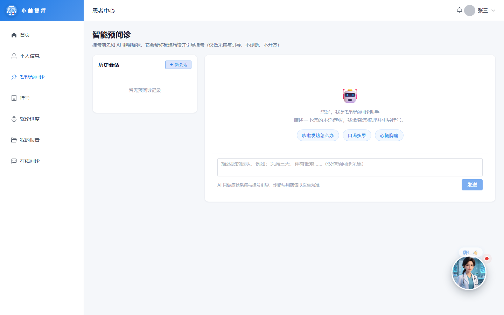
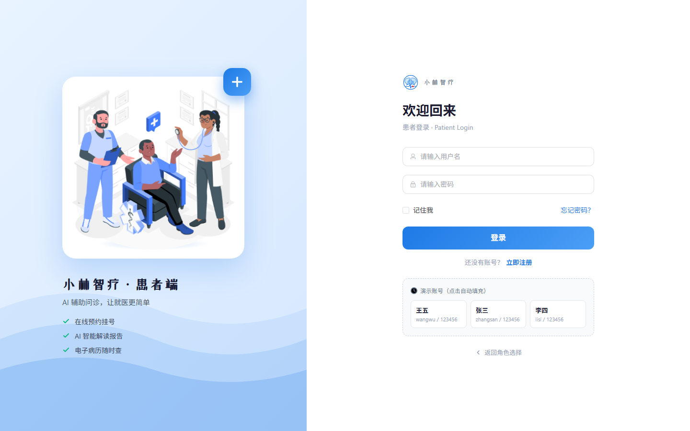
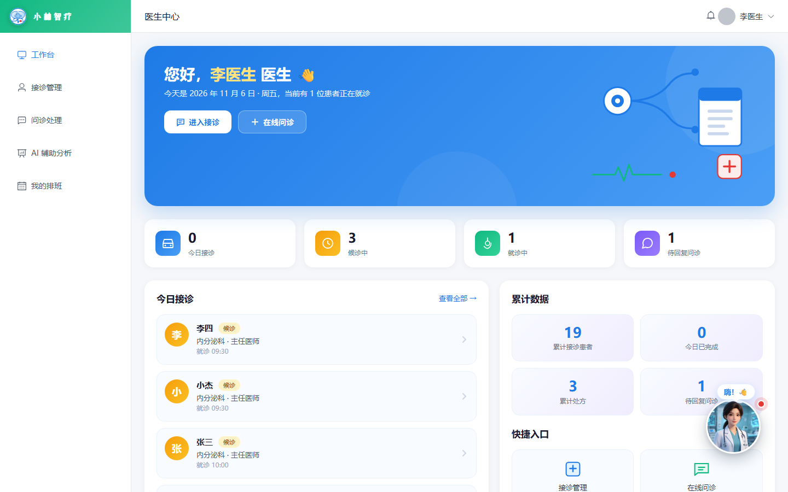
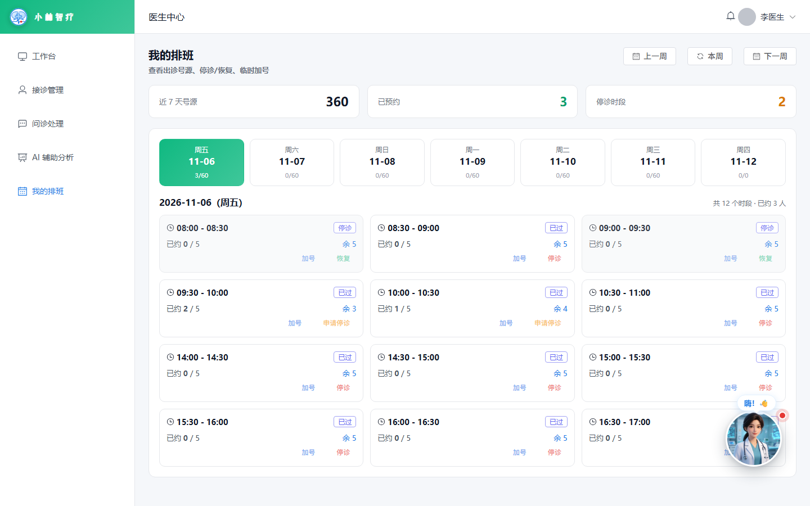
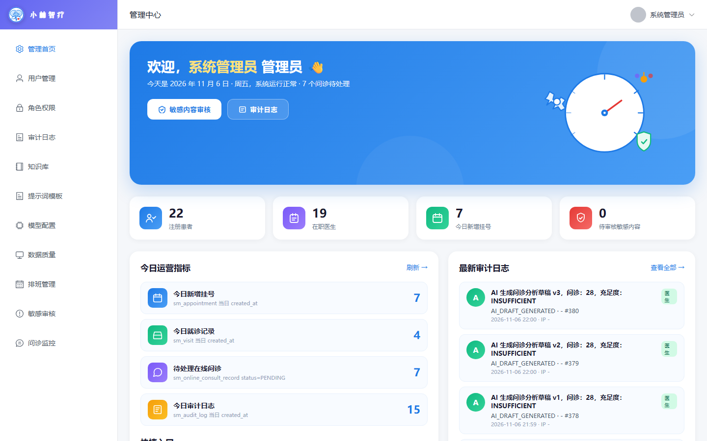
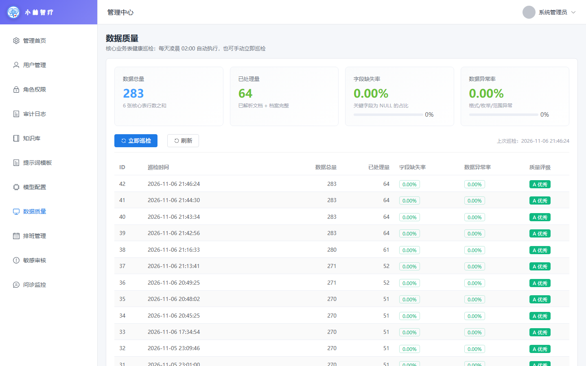
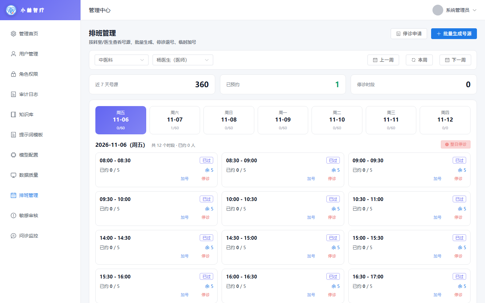
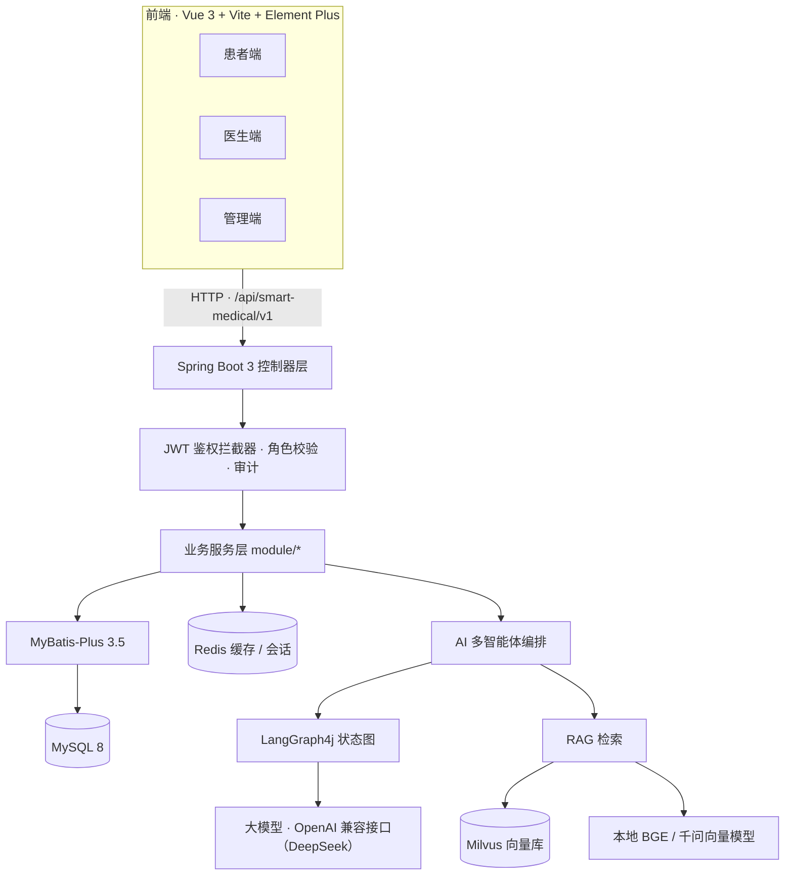
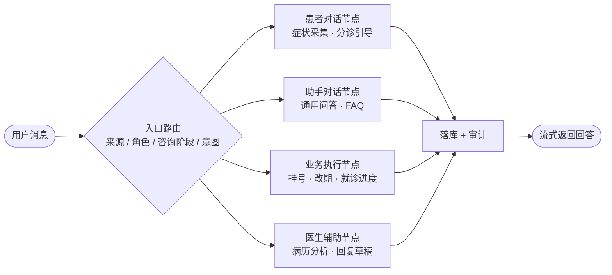

# 小林智疗 · Smart Medical

**AI 驱动的智慧医疗平台** —— 患者 / 医生 / 管理员三端 + AI 多智能体客服

**Spring Boot 3** · **Vue 3** · **MyBatis-Plus** · **Redis** · **Milvus** · **LangChain4j** · **LangGraph4j**

> 本项目为学习 / 课程设计 / 毕业设计作品，**不是** 医疗器械软件；系统中的 AI 输出仅供参考，不构成任何诊疗建议。

---

## 目录

- [项目截图](#项目截图)
- [功能特性](#功能特性)
- [技术架构](#技术架构)
- [AI 多智能体设计](#ai-多智能体设计)
- [目录结构](#目录结构)
- [快速开始](#快速开始)
- [配置说明](#配置说明)
- [数据库与迁移脚本](#数据库与迁移脚本)
- [默认账号](#默认账号)
- [测试与构建](#测试与构建)
- [常见问题](#常见问题)
- [路线图](#路线图)
- [免责声明](#免责声明)

---

## 项目截图

### 患者端

| 首页工作台 | 在线挂号（四步选号） |
| :---: | :---: |
|  |  |

| 智能预问诊（AI 客服） | 患者登录 |
| :---: | :---: |
|  |  |

### 医生端

| 医生工作台 | 我的排班（号源 / 停诊 / 加号） |
| :---: | :---: |
|  |  |

### 管理端

| 管理首页（运营看板） | 数据质量巡检 |
| :---: | :---: |
|  |  |

| 排班管理（批量生成号源） | 门户首页 |
| :---: | :---: |
|  |  |

---

## 功能特性

### 患者端

- 注册 / 登录 / 忘记密码（用户名 + 身份证号 + 手机号三要素校验）
- 个人资料维护、头像上传
- 科室浏览 → 医生选择 → 日期选号 → 确认下单的四步挂号流程
- 预约列表与详情、**取消预约 / 一键改期**
- 就诊记录、电子处方、检查报告查看与上传
- 在线图文问诊（发送消息、接收医生回复）
- **AI 智能预问诊**：症状采集、分诊引导、挂号流程答疑、就诊进度查询，支持多轮会话与流式输出

### 医生端

- 工作台：今日接诊、候诊 / 就诊中、待回复问诊一屏掌握
- 接诊管理与就诊状态推进
- **我的排班**：近 7 天号源、停诊 / 恢复、临时加号、停诊申请
- 在线问诊处理，回复草稿确认后发送
- **AI 辅助分析**：根据病历 / 症状流式生成分析结论
- 电子病历书写与版本留痕

### 管理端

- 运营看板：注册患者、在职医生、今日挂号、待审内容、审计日志
- 用户 / 角色权限 / 审计日志管理
- **排班管理**：按科室与医生批量生成号源、号源容量调整、整日停诊、停诊申请审批
- **数据质量巡检**：定时（每日 02:00）与手动巡检，统计总量 / 已处理量 / 字段缺失率 / 异常率并给出质量评级
- 知识库、提示词模板、模型配置管理
- 敏感内容审核、在线问诊监控

### 平台能力

- 统一返回体与全局异常处理、`traceId` 追踪
- JWT 鉴权 + 角色拦截（PATIENT / DOCTOR / ADMIN），启动校验密钥强度
- Redis 会话状态 + Caffeine 本地缓存，Redis 故障自动降级熔断
- 语义缓存（分类白名单 + 按类 TTL），相似问题直接回放答案，节省大模型 token
- 审计日志、数据迁移脚本、单元测试

---

## 技术架构



| 层次 | 技术选型 |
| --- | --- |
| 后端框架 | Spring Boot 3.4.1、Spring MVC、Bean Validation |
| 持久层 | MyBatis-Plus 3.5.7、MySQL 8/9（utf8mb4） |
| 缓存 / 会话 | Redis（Lettuce）、Caffeine 本地缓存 |
| 安全 | JJWT 0.12.6、自定义拦截器鉴权、BCrypt 密码散列 |
| AI | LangChain4j 1.22.0、LangGraph4j 1.9.6、DeepSeek 等 OpenAI 兼容接口 |
| RAG / 向量库 | Milvus 2.5（etcd + MinIO + standalone）、BGE-small-zh / 千问向量模型 |
| 前端 | Vue 3.5、Vite 8、Vue Router、Pinia、Element Plus、Axios |
| 构建 | Maven（JDK 24）、npm |

### 业务模块

| 模块 | 职责 |
| --- | --- |
| `patient` / `doctor` / `admin` | 三类角色的账号、资料与登录 |
| `appointment` / `schedule` | 预约挂号、号源、排班生成、停诊审批与改期 |
| `visit` / `prescription` / `report` | 就诊记录、电子处方、检查报告 |
| `onlineconsult` | 患者与医生的图文问诊会话 |
| `medicalnote` | 电子病历与版本管理 |
| `notification` | 站内通知与未读提醒 |
| `knowledge` / `prompt` | 知识库、提示词模板 |
| `stats` / `admin` | 运营统计、审计日志、数据质量巡检 |
| `ai` | 多智能体编排、RAG、语义缓存、流式输出 |

---

## AI 多智能体设计

AI 部分不是单一"大模型问答"，而是用 LangGraph4j 把不同场景拆成独立节点，由入口路由统一分发，最终统一落库并写审计。



| 机制 | 说明 |
| --- | --- |
| 意图路由 | `IntentKeywords` + 会话阶段 + 角色共同决定走哪个节点 |
| 工具调用 | `BusinessToolExecutor` 封装挂号 / 改期 / 进度查询等真实业务能力 |
| 语义缓存 | 只缓存流程类与通用常识类（症状、用药不入缓存），按类设置 TTL，阈值可配 |
| 降级策略 | Redis 不可用时自动切换内存状态存储并熔断，避免每个请求都等连接超时 |
| 安全边界 | 系统提示词约束"只做采集与引导，不诊断、不开方"，敏感词过滤 + 医生在环 |
| 流式解析 | `AnalysisStreamParser` 解析增量输出，前端边生成边展示 |

---

## 目录结构

```
smart-medical/
├── smart-medical-backend/                 # Spring Boot 后端（端口 8080）
│   ├── src/main/java/com/hospital/smartmedical/
│   │   ├── common/                        # 统一返回体、异常、鉴权、配置、文件存储
│   │   └── module/                        # 业务模块
│   │       ├── patient / doctor / admin
│   │       ├── appointment / schedule / visit / prescription / report
│   │       ├── onlineconsult / notification / medicalnote / knowledge
│   │       ├── stats / prompt / preconsult
│   │       └── ai/                        # graph / node / tool / rag / cache
│   ├── src/main/resources/
│   │   ├── application.yml                # 主配置
│   │   ├── application-demo.yml           # 演示 profile
│   │   ├── schema.sql / data.sql          # 建表 + 初始数据
│   │   ├── db/migration-*.sql             # 增量迁移脚本
│   │   └── ai-prompts.yaml                # 提示词模板
│   ├── src/test/java/                     # 单元测试
│   └── docs/                              # 开发过程验证记录
├── smart-medical-frontend/                # Vue 3 前端（端口 5173）
│   └── src/{api,components,layouts,router,stores,views}
├── docs/images/                           # README 截图
├── docker-compose-milvus.yml              # Milvus 向量库一键启动
└── 启动命令.txt                            # 本地启动速查
```

---

## 快速开始

### 1. 环境要求

| 依赖 | 版本 | 是否必需 |
| --- | --- | --- |
| JDK | 24（与 `pom.xml` 中 `java.version` 一致） | 必需 |
| Maven | 3.8+ | 必需 |
| Node.js | 18+ | 必需 |
| MySQL | 8.0+ | 必需 |
| Redis | 6.0+ | 必需 |
| Docker | 任意较新版本 | 可选（Milvus） |

### 2. 初始化数据库

```sql
CREATE DATABASE smart_medical DEFAULT CHARACTER SET utf8mb4 COLLATE utf8mb4_general_ci;
```

按顺序执行：

1. `smart-medical-backend/src/main/resources/schema.sql` —— 建表
2. `smart-medical-backend/src/main/resources/data.sql` —— 初始数据
3. `smart-medical-backend/src/main/resources/db/migration-*.sql` —— 按版本号顺序执行增量脚本

### 3. 配置本地密钥

敏感配置不写进仓库。在**后端运行目录**（即 `smart-medical-backend/`）下新建 `ai-secret.yml`（已被 `.gitignore` 忽略）：

```yaml
jwt:
  secret: "请替换为不少于 32 字节的随机字符串"

ai:
  llm:
    api-key: "sk-xxxx"            # DeepSeek 等 OpenAI 兼容接口的 Key
    embedding:
      api-key: "sk-xxxx"          # 向量模型 Key（留空则使用本地 BGE 模型）
```

> 没有大模型 Key 时，把 `application.yml` 里的 `ai.mock-mode` 改为 `true`，AI 会走本地规则回复，业务功能不受影响。

### 4. 启动后端（默认 8080，上下文 `/api/smart-medical/v1`）

```bash
cd smart-medical-backend
mvn spring-boot:run
# 或运行已构建产物
java -jar target/smart-medical-1.0.0.jar
```

### 5. 启动前端（默认 5173）

```bash
cd smart-medical-frontend
npm install
npm run dev
```

前端通过 Vite 代理把 `/api` 转发到 `http://localhost:8080`，无需额外配置跨域。

### 6. （可选）启动 Milvus 向量库

```bash
docker compose -f docker-compose-milvus.yml up -d
```

Milvus 默认地址 `localhost:19530`，知识库集合 `smart_medical_knowledge`。未启动时系统自动回退到内存向量库。

### 7. 演示模式

空库演示时，可用 `--spring.profiles.active=demo` 启动：

- DemoMode 生效，**任意密码 `123456` 均可登录**
- 启动时自动为医生生成近 7 天号源
- 忘记密码接口回显验证码（本地无短信通道）

**生产环境不要启用 demo profile。**

---

## 配置说明

`application.yml` 中所有敏感项都支持环境变量覆盖：

| 环境变量 | 作用 | 默认值 |
| --- | --- | --- |
| `DB_USERNAME` / `DB_PASSWORD` | MySQL 账号密码 | `root` / `123456` |
| `REDIS_HOST` / `REDIS_PORT` / `REDIS_PASSWORD` | Redis 连接 | `localhost` / `6379` / 空 |
| `JWT_SECRET` | JWT 签名密钥（≥ 32 字节，缺失则启动失败） | 无 |
| `AI_LLM_API_KEY` | 大模型 API Key | 空 |
| `AI_EMBEDDING_API_KEY` | 向量模型 API Key | 空 |

关键配置项：

| 配置 | 说明 |
| --- | --- |
| `ai.mock-mode` | `true` 走本地规则回复（不发外部请求） |
| `ai.state-store` | `redis` 会话持久化 / `memory` 纯内存 |
| `ai.semantic-cache.*` | 语义缓存开关、阈值、按类 TTL |
| `ai.llm.base-url` | OpenAI 兼容地址，可换任意厂商 |
| `jwt.expire-minutes` | Token 有效期（默认 24h） |
| `app.schedule.auto-seed` | 空库是否自动补号源（仅 demo 打开） |

---

## 数据库与迁移脚本

- 表统一使用 `sm_` 前缀，共 21 张表，字符集 `utf8mb4`
- `schema.sql` 为全量 DDL，`data.sql` 为种子数据
- `db/migration-v*.sql` 为增量脚本，按版本号顺序执行即可完成升级：

| 脚本 | 内容 |
| --- | --- |
| `migration-v2-appointment.sql` | 预约挂号相关表结构 |
| `migration-v3-prescription.sql` | 处方模块 |
| `migration-v4-doctor-profile.sql` | 医生资料扩展 |
| `migration-v5-patient-profile.sql` | 患者资料扩展 |
| `migration-v6-doctor-analyze.sql` | 医生端 AI 辅助分析 |
| `migration-v7-new-depts.sql` | 新增科室与医生 |

---

## 默认账号

种子数据中的初始密码统一为 `SmartMed@2026`（BCrypt 散列存储）：

| 角色 | 账号 | 密码 |
| --- | --- | --- |
| 患者 | `zhangsan` / `lisi` / `wangwu` | `SmartMed@2026` |
| 医生 | `D001` ~ `D008`（工号） | `SmartMed@2026` |
| 管理员 | `A001` | Demo 简化登录，无需密码 |

> 登录页的 "演示账号" 卡片会把密码填成 `123456`，该密码仅在 `demo` profile 下生效；非 demo 环境请使用上面的真实初始密码。

---

## 测试与构建

```bash
# 后端单元测试
cd smart-medical-backend
mvn test

# 后端打包
mvn clean package -DskipTests && java -jar target/smart-medical-1.0.0.jar

# 前端生产构建（产物在 dist/）
cd smart-medical-frontend
npm run build
```

已覆盖的测试包括：JWT 生成与校验、鉴权拦截器角色控制、并发扣减号源、预约改期、排班影响面、语义缓存规则与流程、AI 意图路由等。

---

## 常见问题

**Q：启动报 "JWT 密钥缺失或过短"？**
A：`jwt.secret` 必须 ≥ 32 字节，通过 `ai-secret.yml` 或环境变量 `JWT_SECRET` 配置。

**Q：前端 5173 端口被占用？**
A：Vite 会自动顺延到 5174，注意后端代理仍指向 8080，不影响使用；也可以 `npm run dev -- --port 5175` 指定端口。

**Q：没有 Milvus / 没有大模型 Key 能跑吗？**
A：能。Milvus 未启动会自动回退内存向量库；把 `ai.mock-mode` 设为 `true` 后 AI 走本地规则回复。

**Q：MySQL 默认连接数不够？**
A：连接池默认 `maximum-pool-size: 50`，请同步调大 MySQL 的 `max_connections`（默认仅 151）。

**Q：演示数据里的号源用完了？**
A：用 `demo` profile 启动会自动补近 7 天号源，或在管理端 "排班管理 → 批量生成号源" 手动生成。

---

## 路线图

- [ ] 接入短信 / 邮件通道，替换演示验证码
- [ ] 医生端 AI 辅助分析的结论可一键写入病历
- [ ] 知识库文档分片策略与重排（rerank）优化
- [ ] 前端补充暗色主题与移动端适配
- [ ] Docker Compose 一键拉起全套依赖（MySQL + Redis + Milvus + 应用）

---

## 免责声明

本项目仅用于技术学习与教学演示，不用于真实诊疗场景；系统中的 AI 生成内容仅供参考，不能替代执业医师的诊断与处方。生产落地前请完成等保、数据合规与医疗器械相关资质评估。
